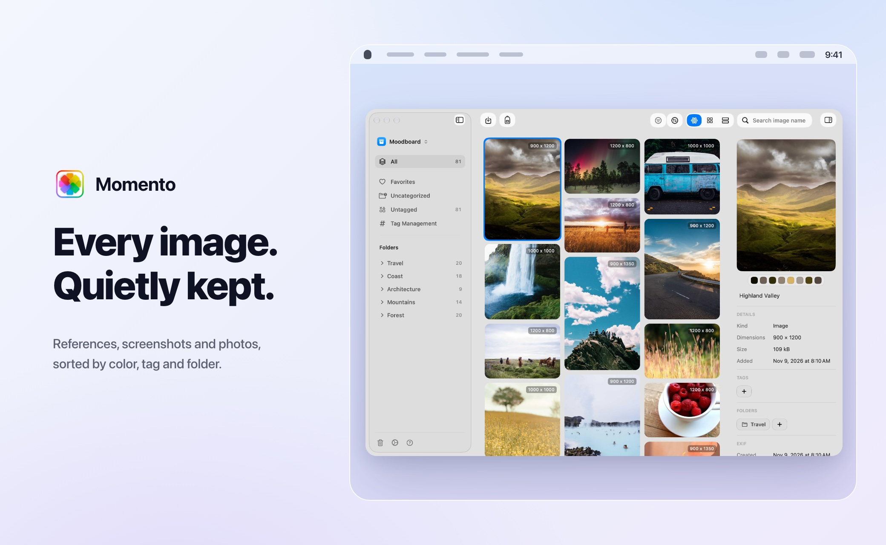

<div align="center">

<a href="https://github.com/Seaony/Momento/releases/latest"></a>

# Momento

### Every image. Quietly kept.

**References, screenshots, moodboards and photos, gathered into a native Mac library.**<br>
Sorted by color, tag and folder, stored on your own disk,<br>
and fast enough for a hundred thousand images.

[](https://github.com/Seaony/Momento/releases/latest) [](https://github.com/Seaony/Momento/stargazers)<br>
  

**[Download](https://github.com/Seaony/Momento/releases/latest)** &nbsp;·&nbsp; **[Browser extension](https://github.com/Seaony/Momento-Chomre-Extension/releases/latest)** &nbsp;·&nbsp; **English** · [简体中文](README.zh-CN.md)

<br>

<picture>
  <source media="(prefers-color-scheme: dark)" srcset="assets/product-dark-en.jpg">
  
</picture>

</div>

<br>

## Is Momento for you?

Images you want to keep end up everywhere: Downloads, the desktop, chat threads, browser tabs, a dozen project folders. When you need one again, you search by memory and usually give up.

Momento keeps them in one library on your Mac:

- **Find by how it looks**: every image's palette is read on import, so you can filter by color as well as by tag, folder and file type.
- **Organize without moving files around**: favorites, tags and nested folders. One image can live in several folders at once.
- **Keep it yours**: the library is a package on your own disk. No account, no cloud, no upload.
- **Stay fast at any size**: the grid is built on AppKit and scrolls smoothly through libraries of 100,000+ images.

It's for you if you collect visual material for work: designers, photographers, content creators, indie developers. If you only keep a handful of images, Finder is enough.

## Quick start

**1 · Install.** Download the DMG from the **[latest release](https://github.com/Seaony/Momento/releases/latest)** and drag `Momento.app` into Applications.

<sub>Needs macOS 15 or later. Releases are signed with an Apple Developer ID and notarised. Momento updates itself from GitHub Releases through Sparkle.</sub>

**2 · Create a library.** On first launch, choose **Create Library**, give it a name and pick where to save it. It's a single `.momento` package you can move, back up or copy like any file.

**3 · Bring images in.** Press `⌘ I`, or drag images and whole folders onto the window. Duplicates are skipped, and folder structure is kept. To save straight from a web page, install the **[browser extension](https://github.com/Seaony/Momento-Chomre-Extension/releases/latest)**.

## What it does

### Three ways to browse

Masonry for loose browsing, a grid for quick scanning, and a list for names, sizes and details. Switch with `⌘ 1`, `⌘ 2` and `⌘ 3`; the view changes, the images don't.

### Find by color, tag and type

Momento reads each image's palette on import and groups it into common color families. Open the filter to narrow the current folder by color, tag or file type, sort by date added, name or size, or search by name with `⌘ F`.

### Folders, tags and favorites

Nest folders as deep as you like and drag them to reorder. Drag images onto a folder to file them, tag several at once from the inspector, and check **Uncategorized** and **Untagged** for what still needs a home.

### Everything about an image

The inspector shows the preview, palette, title, type, dimensions, file size, date added, source link and EXIF data, including camera, lens and exposure when they're there. Click a swatch to copy its color value.

### Save from the browser

With the Momento Image Saver extension for Chrome, right-click an image on any page and send it to Momento. It downloads the image, records the page it came from, and adds it to your library.

### Get images back out

Drag images straight to Finder or the desktop; copying happens in the background. Or export as the original file, JPEG or PNG.

### Safe to delete, safe to move

Deleted images go to Momento's trash first, where you can restore them. Libraries can be renamed, exported, imported and switched from the library menu, and if thumbnails ever look wrong, **Clear Cache and Reload** rebuilds them.

### Built for macOS

Native SwiftUI and AppKit, with Liquid Glass on macOS 26. System, dark and light appearance. English and Simplified Chinese. Quick Preview with `Space`.

## Keyboard shortcuts

| Shortcut | Action | | Shortcut | Action |
| :-- | :-- | :-- | :-- | :-- |
| `⌘ I` | Import | | `⌘ F` | Search |
| `⌘ 1` | Masonry view | | `⌥ ⌘ F` | Toggle filter |
| `⌘ 2` | Grid view | | `⌥ ⌘ S` | Toggle sort |
| `⌘ 3` | List view | | `⌥ ⌘ I` | Toggle inspector |
| `Space` | Quick Preview | | `⌘ ⌫` | Move to Trash |

## Supported files

Common image formats macOS can read, plus GIF. Whether RAW files import depends on your Mac's built-in decoders. SVG, PDF and video aren't imported yet.

A library is a `.momento` package. Originals, thumbnails and the database all live inside it, and the database stores only paths relative to the package, so it keeps working wherever you move it:

```text
<Name>.momento/
├── manifest.json
├── database/library.sqlite
├── assets/<hashPrefix>/<sha256>.<ext>
├── thumbnails/<sha256>.png
├── previews/
└── metadata/import-sessions/
```

## Privacy

- Your images, tags and folders stay in the library package on your Mac. There's no account and nothing is uploaded.
- The browser extension talks to Momento through a port that only accepts connections from your own Mac.
- Momento goes online only to download images you send from the browser, and to check Momento's GitHub Releases feed for updates.

## Build from source

You need Xcode 26 or later.

```sh
git clone https://github.com/Seaony/Momento.git
cd Momento
xcodebuild -project Momento.xcodeproj -scheme Momento -configuration Debug \
  -derivedDataPath "$PWD/DerivedData" build
open DerivedData/Build/Products/Debug/Momento.app
```

Run the tests with:

```sh
xcodebuild -project Momento.xcodeproj -scheme Momento -destination 'platform=macOS' test
```

To publish a release, run `scripts/prepare-release.sh <marketing-version> <build-number>`. It needs a Developer ID Application certificate and a `notarytool` keychain profile in `MOMENTO_NOTARY_PROFILE`. It builds and notarises the app and the DMG, signs the Sparkle update, updates `appcast.xml` and publishes a GitHub Release. Project conventions are in [AGENTS.md](AGENTS.md).

---

<div align="center">
  <sub>Keep what inspires you. Find it again when it matters.</sub>
</div>
