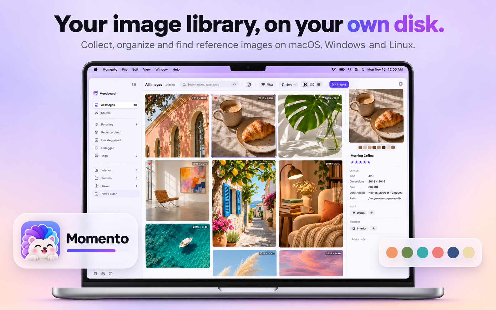

<div align="center">

<a href="https://github.com/Seaony/Momento/releases/latest"></a>

# Momento

### Your image library, on your own disk.

**Reference images, screenshots, photos and short videos, in one local library.**<br>
Organize them by color, tag and folder, find them again when you need them,<br>
with no account and nothing uploaded anywhere.

[](https://github.com/Seaony/Momento/releases/latest) [](https://github.com/Seaony/Momento/stargazers) [](LICENSE)<br>
   

**[Download](https://github.com/Seaony/Momento/releases/latest)** &nbsp;·&nbsp; **[Browser extension](https://github.com/Seaony/Momento-Chomre-Extension)** &nbsp;·&nbsp; **English** · [简体中文](README.zh-CN.md)

<br>



</div>

<br>

## Is Momento for you?

Saved images scatter fast: a batch in Downloads, a pile of screenshots on the desktop, a list of bookmarked links. When you need one, you remember "that pinkish building photo" but not where it went.

Momento keeps them in one library, and the library is a single `.momento` folder on your disk:

- **Find images by how they look**: every image gets a color palette, so you can filter by color, tag, format and rating, and search names, notes and source links.
- **Organize without effort**: nested folders, tags, ratings and smart folders, all editable in batches. Drag in, paste or drop into a watched folder, and images are imported with duplicates skipped.
- **Your files stay yours**: copy, move or back up the whole library like any folder. No account, no cloud sync, no analytics.
- **One interface on three platforms**: macOS, Windows and Linux share the same native interface, in English, Chinese and Japanese.

If you collect references, screenshots or photos and would rather not hand them to a cloud service, it is for you. If you only want your photos synced between your phone and computer, your system's photo app suits you better.

> [!NOTE]
> The Windows build is not code-signed yet, so SmartScreen warns the first time you open it: choose More info, then Run anyway. Camera RAW and PSD files do not open on Linux yet.

## Quick start

**1 · Install.** Download from the **[latest release](https://github.com/Seaony/Momento/releases/latest)**: the DMG for macOS, the `setup` program for Windows, or DEB, RPM or tar.gz for Linux.

<sub>The macOS app runs on Apple silicon and Intel, and is signed with a Developer ID and notarized by Apple. Momento checks GitHub Releases for updates; you can turn that off in Settings.</sub>

**2 · Create a library.** The first time you open Momento, create a library and pick where its `.momento` folder goes.

**3 · Add images.** Drag them into the window, paste with `⌘V`, or choose files with `⌘I`. Save images from web pages with a right-click using the [browser extension](https://github.com/Seaony/Momento-Chomre-Extension).

## Features

### Three ways to look

Masonry for scanning many images at once, justified rows for neat full-width rows, and a list for names and sizes. Press Space to open a preview window that zooms, pans and plays animated images and videos; press H to flip horizontally and G for grayscale. You can also run a full-screen slideshow of the current list.

### Find by color and tag

Every image gets an 8-color palette on import. Filter by color, tag and extension, or search names, notes, source links and tags. Smart folders collect images by rules, such as "added this month, 4 stars or more, mostly blue PNGs".

### Organize

Nested folders, tags, favorites, 1 to 5 star ratings and notes, all editable for many images at once. Copy tags from one image and paste them onto others. Batch rename numbers files from a template or finds and replaces text.

### Duplicates, annotations and export

Find Similar Images groups images that look the same; pick one to keep, and the tags, folders, notes and ratings of the others are merged into it before they go to the trash. Draw a box on an image to leave an annotation, and annotations are searchable too. Export to JPEG or PNG with an optional longest-edge limit, and save the settings you use often as presets.

### Import

Drag in, paste, or choose files or whole folders, with duplicates detected by content. Watched folders import anything you put in them and move the originals to the trash. Keywords embedded in images can become tags.

| Kind | Formats |
|---|---|
| Images | JPEG, PNG, GIF, WebP, TIFF, BMP, HEIC, AVIF |
| Camera RAW and more | DNG, CR2, CR3, NEF, ARW, RAF, ORF, RW2 and others, plus PSD, JPEG 2000, TGA, EXR, HDR. Full support on macOS; Windows only gets the system thumbnail, up to 2560 pixels; not supported on Linux yet |
| Videos | MP4, MOV, M4V, WebM. WebM on macOS and videos on Linux need ffmpeg for their cover frames |
| Live Photos | A HEIC or JPEG with a MOV of the same name, paired on import and exported together if you like |

### Also

A password lock, a menu bar icon, launch at login, customizable shortcuts, and light and dark appearances.

<details>
<summary><b>Default shortcuts</b></summary>

<br>

These are the macOS keys; on Windows and Linux use `Ctrl` for `⌘` and `Alt` for `⌥`. Change any of them on the Shortcuts page in Settings.

| Action | Keys |
|---|---|
| New / open library | `⌘N` / `⌘O` |
| Import files / folder | `⌘I` / `⌘⇧I` |
| Export | `⌘E` |
| Masonry / list / justified rows | `⌘1` / `⌘2` / `⌘3` |
| Search | `⌘K` |
| Filter / sort | `⌘⌥F` / `⌘⌥S` |
| Show or hide inspector | `⌘⌥I` |
| Larger / smaller thumbnails | `⌘=` / `⌘-` |
| Copy / paste tags | `⌘⇧C` / `⌘⇧V` |
| Add to folder | `⇧F` |
| Preview | `Space` |
| Flip / grayscale / annotate in preview | `H` / `G` / `A` |
| Lock | `⌘L` |
| Settings | `⌘,` |

</details>

## Data and privacy

- A library is a `.momento` folder holding the originals, their thumbnails and a SQLite database. The database stores only relative paths, so the folder can be moved, copied or backed up as a whole. On macOS a library in use cannot live in iCloud Drive.
- Settings are saved in `preferences.json`: `~/Library/Application Support/Momento/` on macOS, `%APPDATA%\Momento\` on Windows, `~/.config/Momento/` on Linux.
- Logs rotate at 5 MB and keep three older files: `~/Library/Logs/Momento/` on macOS, `%LOCALAPPDATA%\Momento\Logs\` on Windows, `~/.local/state/momento/` on Linux.
- Momento has no analytics. It goes online for two things only: checking GitHub Releases for updates at launch, and downloading images you import through the browser extension or a link. The extension talks only to `127.0.0.1:47641` on your own computer.
- The password lock covers the interface only; it does not encrypt files. If you forget the password, quit Momento and delete `passwordHash` from `preferences.json`.

## Build from source

You need Go 1.27.3 or later, and GTK 3 on Linux. No Node, web frontend or cgo.

```sh
git clone https://github.com/Seaony/Momento.git
cd Momento/app
go tool mygo dev     # opens the app and rebuilds it when the code changes
go test ./...
```

`go tool mygo build -platform darwin/universal,windows/amd64,windows/arm64,linux/amd64,linux/arm64` builds packages for all three platforms into `app/build/`; a DMG needs a Mac and Windows installers need NSIS. `go run ./cmd/sample-library -path /tmp/sample.momento -count 14` creates a sample library. See [RELEASING.md](.github/RELEASING.md) for releases and [AGENTS.md](AGENTS.md) for project conventions.

## Credits

The interface and packaging use [mygo](https://github.com/egoist/mygo), the database is [modernc.org/sqlite](https://gitlab.com/cznic/sqlite), AVIF and HEIC decoding come from [gen2brain/avif](https://github.com/gen2brain/avif) and [gen2brain/h265](https://github.com/gen2brain/h265), and EXIF reading from [imagemeta](https://github.com/evanoberholster/imagemeta). Icons are from [Solar Icons](https://icon-sets.iconify.design/solar/) (CC BY 4.0) and [Tabler Icons](https://tabler.io/icons) (MIT).

Momento is open source under the [MIT License](LICENSE).

---

<div align="center">
  <sub>Every image you keep, ready when you need it.</sub>
</div>
