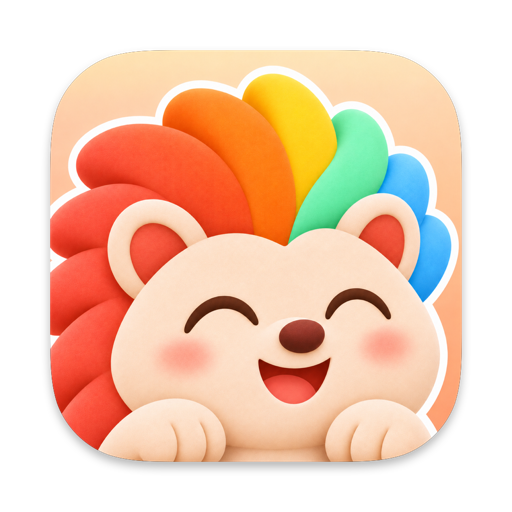
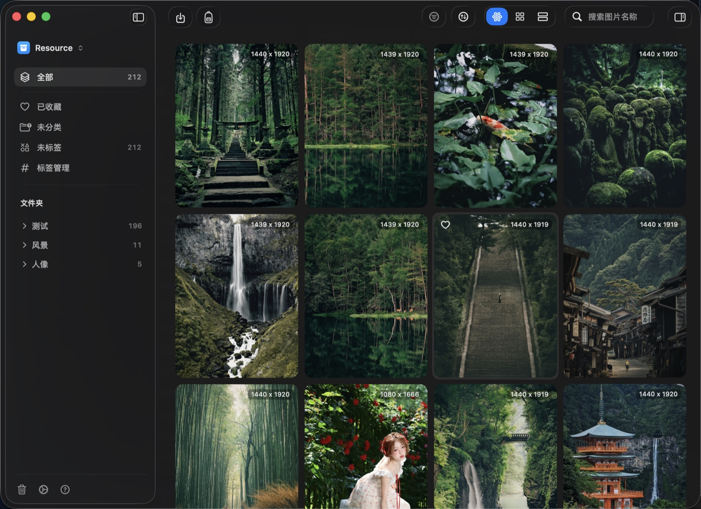

<div align="center">

<a href="https://github.com/Seaony/Momento/releases/latest"></a>

# Momento

### 想留下的图，都收进一个安静的素材库。

**参考图、截图、Moodboard 和照片，收进一个原生 Mac 素材库。**<br>
按颜色、标签和文件夹整理，保存在你自己的磁盘上，<br>
十万张图也照样流畅。

[](https://github.com/Seaony/Momento/releases/latest) [](https://github.com/Seaony/Momento/stargazers)<br>
  

**[下载](https://github.com/Seaony/Momento/releases/latest)** &nbsp;·&nbsp; **[浏览器扩展](https://github.com/Seaony/Momento-Chomre-Extension/releases/latest)** &nbsp;·&nbsp; [English](README.md) · **简体中文**

<br>



</div>

<br>

## Momento 适合你吗？

想留下的图片总是散在各处：下载目录、桌面、聊天记录、浏览器标签页，还有十几个项目文件夹。真要用的时候只能凭记忆翻，翻着翻着就放弃了。

Momento 把它们收进 Mac 上的一个素材库：

- **按样子找图**：导入时读取每张图的调色板，除了标签、文件夹和文件类型，还能按颜色筛选。
- **整理不用挪文件**：收藏、标签和多层文件夹。同一张图可以同时放进好几个文件夹。
- **数据是你自己的**：素材库是你磁盘上的一个包。不用账号，没有云端，不会上传。
- **多大都不卡**：资源网格基于 AppKit 实现，十万张以上的素材库也能流畅滚动。

如果你因为工作要收集视觉素材，比如设计师、摄影师、内容创作者、独立开发者，它适合你。如果只存几张图，用 Finder 就够了。

## 快速开始

**1 · 安装。** 从 **[最新版本](https://github.com/Seaony/Momento/releases/latest)** 下载 DMG，把 `Momento.app` 拖进“应用程序”。

<sub>需要 macOS 15 或更高版本。安装包使用 Apple Developer ID 签名并经过公证。Momento 会通过 Sparkle 从 GitHub Releases 自动更新。</sub>

**2 · 新建资源库。** 首次打开时选择 **新建资源库**，起个名字并选择保存位置。它是一个 `.momento` 包，可以像普通文件一样移动、备份或复制。

**3 · 导入图片。** 按 `⌘ I`，或者直接把图片和整个文件夹拖进窗口。重复的文件会自动跳过，文件夹层级会保留。想在网页上直接保存，安装 **[浏览器扩展](https://github.com/Seaony/Momento-Chomre-Extension/releases/latest)**。

## 功能

### 三种浏览方式

瀑布流适合随意浏览，网格适合快速扫一遍，列表适合看名称、尺寸和信息。用 `⌘ 1`、`⌘ 2`、`⌘ 3` 切换；变的只是浏览方式，素材本身不动。

### 按颜色、标签和类型找图

导入时，Momento 会读取每张图的调色板并归入常用色系。打开筛选，可以在当前文件夹里按颜色、标签或文件类型缩小范围；也可以按添加时间、名称或大小排序，或者用 `⌘ F` 按名称搜索。

### 文件夹、标签和收藏

文件夹可以一层层往下建，拖动就能调整顺序。把图片拖到文件夹上就能归类，在检查器里可以给多张图一起打标签；**未分类** 和 **未标签** 里是还没整理的图。

### 一张图的全部信息

检查器显示预览、色板、标题、类型、尺寸、文件大小、添加时间、来源链接和 EXIF，能读到的相机、镜头和曝光参数都会列出来。点一下色块就能复制色值。

### 从浏览器直接保存

装上 Chrome 扩展 Momento Image Saver 后，在任意网页上右键图片就能发送给 Momento。它会下载图片、记下来源页面，并加进你的素材库。

### 图片怎么进来就能怎么出去

选中图片直接拖到 Finder 或桌面，复制在后台完成。也可以导出为原文件、JPEG 或 PNG。

### 删了能找回，库能随便搬

删除的图片先进 Momento 的废纸篓，随时可以恢复。在资源库菜单里可以重命名、导出、导入和切换资源库；缩略图显示不对时，用 **清除缓存并重新加载** 重新生成。

### 为 macOS 而做

原生 SwiftUI 与 AppKit，macOS 26 上使用 Liquid Glass。支持系统、深色、浅色外观，以及英文和简体中文。按 `Space` 快速预览。

## 快捷键

| 快捷键 | 操作 | | 快捷键 | 操作 |
| :-- | :-- | :-- | :-- | :-- |
| `⌘ I` | 导入资源 | | `⌘ F` | 聚焦搜索 |
| `⌘ 1` | 瀑布流视图 | | `⌥ ⌘ F` | 切换筛选 |
| `⌘ 2` | 网格视图 | | `⌥ ⌘ S` | 切换排序 |
| `⌘ 3` | 列表视图 | | `⌥ ⌘ I` | 切换检查器 |
| `Space` | 快速预览 | | `⌘ ⌫` | 移到废纸篓 |

## 支持的文件

macOS 能识别的常见图片格式，以及 GIF。RAW 能否导入，取决于当前系统自带的解码能力。SVG、PDF 和视频暂不支持导入。

素材库是一个 `.momento` 包。原文件、缩略图和数据库都在包里，数据库只保存相对于包的路径，所以把库挪到哪里都能正常打开：

```text
<Name>.momento/
├── manifest.json
├── database/library.sqlite
├── assets/<hashPrefix>/<sha256>.<ext>
├── thumbnails/<sha256>.png
├── previews/
└── metadata/import-sessions/
```

## 隐私

- 图片、标签和文件夹都保存在你 Mac 上的素材库包里。不需要账号，什么都不会上传。
- 浏览器扩展通过一个只接受本机连接的端口和 Momento 通信。
- Momento 只在两种情况下联网：下载你从浏览器发来的图片，以及访问 Momento 的 GitHub Releases 检查更新。

## 从源码构建

需要 Xcode 26 或更高版本。

```sh
git clone https://github.com/Seaony/Momento.git
cd Momento
xcodebuild -project Momento.xcodeproj -scheme Momento -configuration Debug \
  -derivedDataPath "$PWD/DerivedData" build
open DerivedData/Build/Products/Debug/Momento.app
```

运行测试：

```sh
xcodebuild -project Momento.xcodeproj -scheme Momento -destination 'platform=macOS' test
```

发布新版本运行 `scripts/prepare-release.sh <版本号> <构建号>`。需要 Developer ID Application 证书，以及配置在 `MOMENTO_NOTARY_PROFILE` 里的 `notarytool` 钥匙串配置。脚本会构建并公证 App 和 DMG、签名 Sparkle 更新包、更新 `appcast.xml`，然后发布 GitHub Release。工程约定见 [AGENTS.md](AGENTS.md)。

---

<div align="center">
  <sub>留下打动你的东西，需要时一下就能找到。</sub>
</div>
