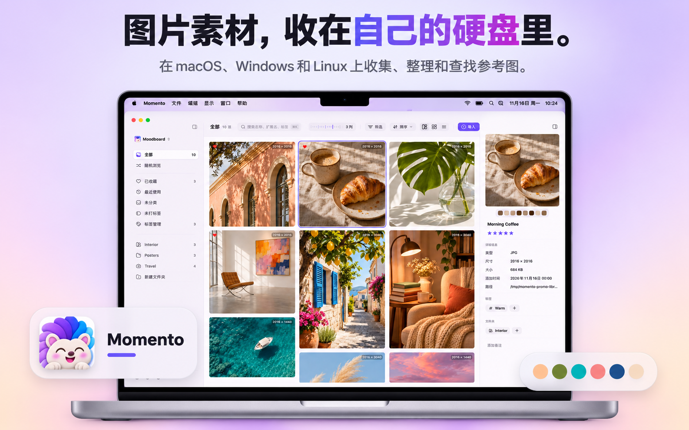

<div align="center">

<a href="https://github.com/Seaony/Momento/releases/latest"></a>

# Momento

### 图片素材，收在自己的硬盘里。

**参考图、截图、照片和短视频，放进同一个本地图库。**<br>
按颜色、标签和文件夹整理，想找的时候搜得到，<br>
不用账号，也不往任何地方上传。

[](https://github.com/Seaony/Momento/releases/latest) [](https://github.com/Seaony/Momento/stargazers) [](LICENSE)<br>
   

**[下载](https://github.com/Seaony/Momento/releases/latest)** &nbsp;·&nbsp; **[浏览器扩展](https://github.com/Seaony/Momento-Chomre-Extension)** &nbsp;·&nbsp; [English](README.md) · **简体中文**

<br>



</div>

<br>

## Momento 适合你吗？

存下来的图很快就散了：下载文件夹里一批，桌面上一堆截图，浏览器书签里还有一堆链接。等到要用的时候，只记得「那张偏粉的建筑照片」，却想不起放在哪。

Momento 把它们收进一个图库，图库就是硬盘上的一个 `.momento` 文件夹：

- **按看到的样子找**：每张图自动提取色板，可以按颜色、标签、格式和评分筛选，名称、备注和来源链接都能搜。
- **整理不费事**：嵌套文件夹、标签、星级和智能文件夹，都能批量改；拖进来、粘贴进来、放进监视的文件夹，都会自动导入并去重。
- **文件始终是你的**：整个图库可以直接复制、移动和备份；不需要账号，不联网同步，也不做任何统计。
- **三个平台一套界面**：macOS、Windows 和 Linux 用同一套原生界面，支持中文、英文和日语。

如果你经常收集参考图、截图或照片，又不想交给云端服务保管，它适合你。如果你只想在手机和电脑之间同步相册，系统自带的照片 App 更合适。

> [!NOTE]
> Windows 版还没有代码签名，第一次打开时 SmartScreen 会提示，点「更多信息」再点「仍要运行」。Linux 上暂时打不开相机 RAW 和 PSD。

## 快速开始

**1 · 安装。** 从 **[最新版本](https://github.com/Seaony/Momento/releases/latest)** 下载：macOS 用 DMG，Windows 用 `setup` 安装程序，Linux 用 DEB、RPM 或 tar.gz。

<sub>macOS 版同时支持 Apple 芯片和 Intel，已用 Developer ID 签名并通过 Apple 公证。Momento 会从 GitHub Releases 检查更新，可以在设置里关掉。</sub>

**2 · 建一个图库。** 第一次打开时新建图库，选一个放 `.momento` 文件夹的位置。

**3 · 把图放进来。** 直接拖进窗口，或者 `⌘V` 粘贴、`⌘I` 选文件。网页上的图片可以用 [浏览器扩展](https://github.com/Seaony/Momento-Chomre-Extension) 右键保存。

## 功能

### 三种看法

瀑布流适合一眼扫过很多图，等高行让每一行整齐排满，列表方便看文件名和大小。按空格打开预览窗口，可以缩放、平移、播放动图和视频，按 H 水平翻转、按 G 看灰度。也可以全屏放映当前列表。

### 按颜色和标签找

每张图导入时自动提取 8 色色板。可以按颜色、标签和扩展名筛选，也可以搜名称、备注、来源链接和标签。智能文件夹按条件自动收集图片，比如「这个月加的、4 星以上、偏蓝的 PNG」。

### 整理

嵌套文件夹、标签、收藏、1 到 5 星评分和备注，都能多选后一次改完。标签可以复制后粘贴到别的图上。批量重命名可以按模板编号，也可以查找替换。

### 查重、批注和导出

「查找相似图片」把看起来一样的图分成一组，选一张保留，其余几张的标签、文件夹、备注和评分并进来，然后移到回收站。在图上框出一块区域就能写批注，批注也能被搜到。导出时可以转成 JPEG 或 PNG、限制最长边，常用的设置存成预设。

### 导入

拖入、粘贴、选文件或整个文件夹，按内容去重。可以监视几个文件夹，放进去的图自动导入，原文件移到废纸篓。图片里自带的关键字可以直接变成标签。

| 类型 | 格式 |
|---|---|
| 图片 | JPEG、PNG、GIF、WebP、TIFF、BMP、HEIC、AVIF |
| 相机 RAW 等 | DNG、CR2、CR3、NEF、ARW、RAF、ORF、RW2 等，以及 PSD、JPEG 2000、TGA、EXR、HDR。macOS 完整支持；Windows 只取系统缩略图，最长 2560 像素；Linux 暂不支持 |
| 视频 | MP4、MOV、M4V、WebM。macOS 上的 WebM 和 Linux 上的视频需要装 ffmpeg 才有封面 |
| 实况照片 | 同名的 HEIC 或 JPEG 加 MOV，导入时自动配对，导出时可以一起导出 |

### 其他

密码锁、菜单栏图标、开机启动、可以改的快捷键，以及浅色和深色外观。

<details>
<summary><b>默认快捷键</b></summary>

<br>

下面是 macOS 的按键，Windows 和 Linux 把 `⌘` 换成 `Ctrl`、`⌥` 换成 `Alt`。都可以在设置的「快捷键」页修改。

| 操作 | 按键 |
|---|---|
| 新建 / 打开图库 | `⌘N` / `⌘O` |
| 导入文件 / 文件夹 | `⌘I` / `⌘⇧I` |
| 导出 | `⌘E` |
| 瀑布流 / 列表 / 等高行 | `⌘1` / `⌘2` / `⌘3` |
| 搜索 | `⌘K` |
| 筛选 / 排序 | `⌘⌥F` / `⌘⌥S` |
| 显示或隐藏检查器 | `⌘⌥I` |
| 放大 / 缩小缩略图 | `⌘=` / `⌘-` |
| 复制 / 粘贴标签 | `⌘⇧C` / `⌘⇧V` |
| 加入文件夹 | `⇧F` |
| 预览 | `Space` |
| 预览里翻转 / 灰度 / 批注 | `H` / `G` / `A` |
| 锁定 | `⌘L` |
| 设置 | `⌘,` |

</details>

## 数据和隐私

- 图库是一个 `.momento` 文件夹，里面是原图、缩略图和一个 SQLite 数据库。数据库只记相对路径，整个文件夹可以随意移动、复制和备份。macOS 上正在用的图库不能放进 iCloud Drive。
- 设置存在 `preferences.json`：macOS 在 `~/Library/Application Support/Momento/`，Windows 在 `%APPDATA%\Momento\`，Linux 在 `~/.config/Momento/`。
- 日志满 5 MB 轮换，保留三份：macOS 在 `~/Library/Logs/Momento/`，Windows 在 `%LOCALAPPDATA%\Momento\Logs\`，Linux 在 `~/.local/state/momento/`。
- Momento 不做任何统计。它只会联网做两件事：启动时到 GitHub Releases 检查更新，以及下载你通过浏览器扩展或链接要导入的图片。扩展只连本机的 `127.0.0.1:47641`。
- 密码锁只锁界面，不加密文件。忘了密码就先退出 Momento，再删掉 `preferences.json` 里的 `passwordHash`。

## 从源码构建

需要 Go 1.27.3 或更高版本；Linux 还需要 GTK 3。不需要 Node、网页前端或 cgo。

```sh
git clone https://github.com/Seaony/Momento.git
cd Momento/app
go tool mygo dev     # 打开应用窗口，改了代码自动重新构建
go test ./...
```

`go tool mygo build -platform darwin/universal,windows/amd64,windows/arm64,linux/amd64,linux/arm64` 一次打出三个平台的安装包，放在 `app/build/`；打 DMG 需要 Mac，打 Windows 安装程序需要 NSIS。`go run ./cmd/sample-library -path /tmp/sample.momento -count 14` 生成一个样本图库。发版步骤见 [RELEASING.md](.github/RELEASING.md)，项目约定见 [AGENTS.md](AGENTS.md)。

## 致谢

界面和打包用的是 [mygo](https://github.com/egoist/mygo)，数据库是 [modernc.org/sqlite](https://gitlab.com/cznic/sqlite)，AVIF 和 HEIC 解码来自 [gen2brain/avif](https://github.com/gen2brain/avif) 和 [gen2brain/h265](https://github.com/gen2brain/h265)，EXIF 读取用 [imagemeta](https://github.com/evanoberholster/imagemeta)。图标来自 [Solar Icons](https://icon-sets.iconify.design/solar/)（CC BY 4.0）和 [Tabler Icons](https://tabler.io/icons)（MIT）。

Momento 以 [MIT 许可证](LICENSE) 开源。

---

<div align="center">
  <sub>存下的每张图，想用的时候都找得到。</sub>
</div>
